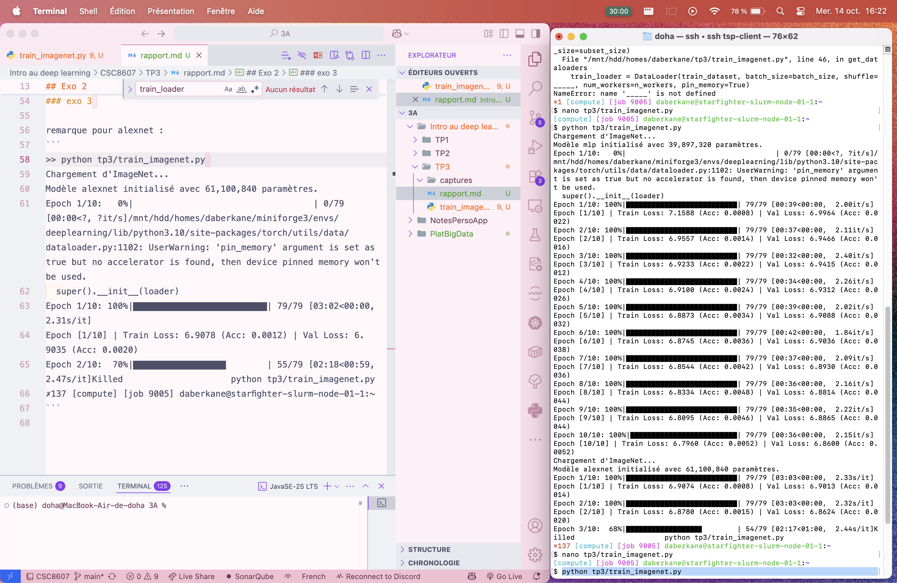

## Exo 1

### q1
1) Sans normalisation, le modèle avance à l'aveugle dans un paysage mathématique chaotique où les calculs s'emballent ou s'éteignent, et calculer les statistiques sur le jeu d'entraînement évite de tricher en lui donnant à l'avance les réponses du jeu de test.

2) On utilise RandomResizedCrop et RandomHorizontalFlip sur le jeu d'entraînement car cela permet de créer des variantes à partir des mêmes images pour éviter qu'il y ait d'overfitting. Et du coup ça l'oblige à se concentrer sur les formes importantes de l'objet plutôt que sur sa position exacte dans l'image.

On utlise Resize + CenterCrop (sans flip) est déterministe. Les images sont toujours présentées de la même manière, comme un examen passé dans des conditions identiques et les scores sont donc reproductibles et comparables, et du coup reflètent les vrais progrès du modèle

3) Par exemple, dans la reconnaissance des panneaux de signalisation, utiliser le RandomHorizontalFlip est néfaste car un panneau indiquant de tourner à droite se retrouverait inversé vers la gauche. Du coup ça contredirait son étiquette d'origine et fausserait l'apprentissage du modèle.


## Exo 2
### etape 1
#### q2a

1) TODO: Mettre image

2) Le défaut structurel majeur du MLP lorsqu'on lui fournit une image aplatie c'est que celui-ci perd l'information de voisinage entre les pixels; on ne sait plus quels pixels sont proches: du coup il faut réapprendre chaque motif pour chaque position de l'image.

### etape 2
#### q2b
1)
| Couche | Taille entrée (C, H×W) | Hyperparamètres (Filtres/Neurones, K, S, P) | Taille sortie (C, H×W) | # Paramètres (avec biais) | Mémoire sortie (KB) |
|---|---|---|---|---|---|
| Conv1 + ReLU | 3, 227×227 | 64 filtres, K=11, S=4, P=2 | 64, 56×56 | 23 296 | 784 |
| MaxPool1 | 64, 56×56 | K=3, S=2, P=0 | 64, 27×27 | 0 | 182,25 |
| Conv2 + ReLU | 64, 27×27 | 192 filtres, K=5, S=1, P=2 | 192, 27×27 | 307 392 | 546,75 |
| MaxPool2 | 192, 27×27 | K=3, S=2, P=0 | 192, 13×13 | 0 | 126,75 |
| Conv3 + ReLU | 192, 13×13 | 384 filtres, K=3, S=1, P=1 | 384, 13×13 | 663 936 | 253,5 |
| Conv4 + ReLU | 384, 13×13 | 256 filtres, K=3, S=1, P=1 | 256, 13×13 | 884 992 | 169 |
| Conv5 + ReLU | 256, 13×13 | 256 filtres, K=3, S=1, P=1 | 256, 13×13 | 590 080 | 169 |
| MaxPool3 | 256, 13×13 | K=3, S=2, P=0 | 256, 6×6 | 0 | 36 |
| Flatten + Dropout | 256, 6×6 | p = 0,5 | 9 216 (1D) | 0 | 36 |
| Linear1 + ReLU + Dropout | 9 216 | 4096 neurones (p = 0,5) | 4 096 | 37 752 832 | 16 |
| Linear2 + ReLU | 4 096 | 4096 neurones | 4 096 | 16 781 312 | 16 |
| Linear3 (Sortie) | 4 096 | 1000 classes | 1 000 | 4 097 000 | 3,91 |
| **Total** | | | | **61 100 840** | **≈ 2 339** |


-----

2) Dans AlexNet, l'essentiel des paramètres se concentre dans les couches Linear(env. 96 %) car le Flatten donne une grosse entrée alors que les convolutions partagent leurs poids; la mémoire des activations est dans les premières convolutions(env. 65 %) car les cartes y sont encore grandes avant le downsampling

3) AlexNet a environ 400 fois plus d’activations que le MLP (2 340 KB contre 6 KB), malgré un nombre de paramètres comparable.
Le paradoxe c'est que beaucoup de paramètres ne veut pas dire beaucoup d’activations parce que les deux dépendent de choses différentes.

#### q2c

> python tp3/train_imagenet.py 
MLP    : 39,897,320 paramètres
AlexNet: 61,100,840 paramètres

## Exo 3 

remarque pour alexnet:
```python
>> python tp3/train_imagenet.py 
Chargement d'ImageNet...
Modèle alexnet initialisé avec 61,100,840 paramètres.
Epoch 1/10:   0%|                                   | 0/79 [00:00<?, ?it/s]/mnt/hdd/homes/daberkane/miniforge3/envs/deeplearning/lib/python3.10/site-packages/torch/utils/data/dataloader.py:1102: UserWarning: 'pin_memory' argument is set as true but no accelerator is found, then device pinned memory won't be used.
  super().__init__(loader)
Epoch 1/10: 100%|██████████████████████████| 79/79 [03:02<00:00,  2.31s/it]
Epoch [1/10] | Train Loss: 6.9078 (Acc: 0.0012) | Val Loss: 6.9035 (Acc: 0.0020)
Epoch 2/10:  70%|██████████████████        | 55/79 [02:18<00:59,  2.47s/it]Killed                     python tp3/train_imagenet.py
✗137 [compute] [job 9005] daberkane@starfighter-slurm-node-01-1:~
```

1) `model.train()` active le Dropout: certains neurones sont éteints aléatoirement à chaque passage pour éviter que le réseau apprenne les données par cœur. `model.eval()` lui le désactive pour que tous les neurones participent à la prédiction. Si on oublie `model.eval()`, la val_loss sera faussement élevée et on ne verra pas les vraies performances du modèle.

2) Au départ le modèle choisit au hasard parmi 1000 classes, donc on s’attend à une accuracy de 0,1% et une loss de ln(1000) environ égale à 6,908. Notre époque 1 donne Train Loss: 6.9078 et Accuracy: 0.0012, ce qui est cohérent.

3) AlexNet apprend mieux car il garde la structure spatiale de l’image grâce aux convolutions. Le MLP lui l’aplatit complètement, donc il perd l’information de voisinage entre pixels. Le MLP overfit aussi plus vite: 40M de paramètres pour seulement 20 000 images, c’est trop. AlexNet s’en sort mieux grâce au Dropout et au partage des poids.

### etape 2
Résultat : 

```python 

>> python tp3/train_imagenet.py 
Chargement d'ImageNet...
Modèle alexnet_deep initialisé avec 62,871,080 paramètres.
Epoch 1/10:   0%|                                   | 0/79 [00:00<?, ?it/s]/mnt/hdd/homes/daberkane/miniforge3/envs/deeplearning/lib/python3.10/site-packages/torch/utils/data/dataloader.py:1102: UserWarning: 'pin_memory' argument is set as true but no accelerator is found, then device pinned memory won't be used.
  super().__init__(loader)
Epoch 1/10: 100%|██████████████████████████| 79/79 [03:31<00:00,  2.68s/it]
Epoch [1/10] | Train Loss: 6.9081 (Acc: 0.0014) | Val Loss: 6.9072 (Acc: 0.0016)
Epoch 2/10:  34%|████████▉                 | 27/79 [01:20<02:30,  2.89s/it]Killed                     python tp3/train_imagenet.py

```
C’est du sous-apprentissage car la train_loss ne descend pas. On eremarque que le gradient disparaît en remontant à travers trop de couches (vanishing gradient). Et donc les premières couches n’apprennent presque rien.

## Exo 4

TODO 