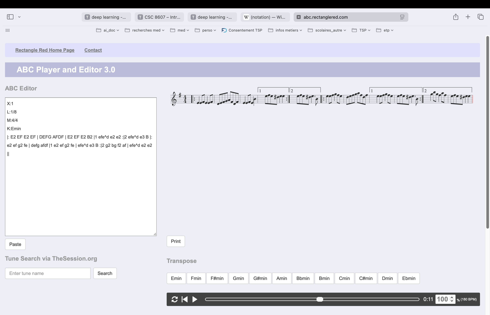
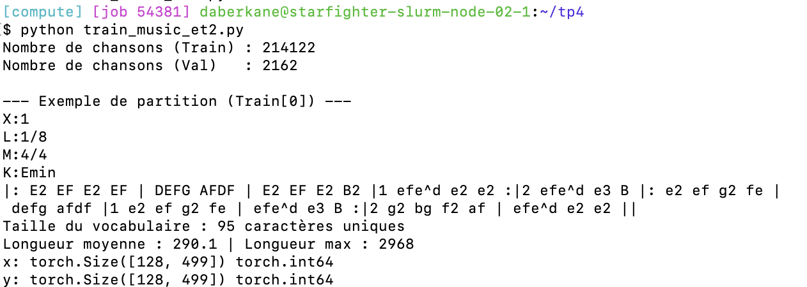
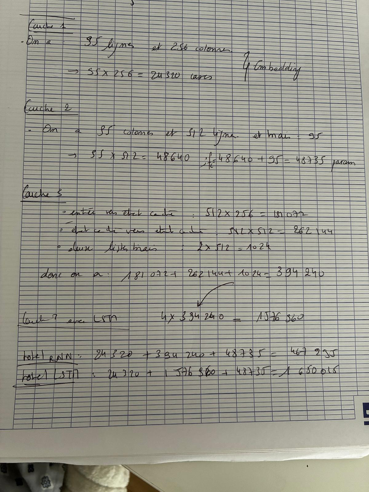
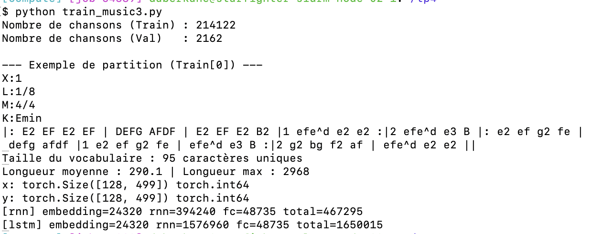
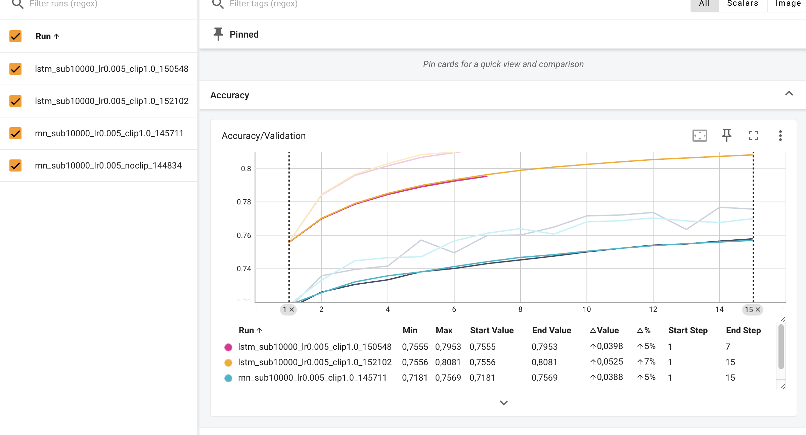
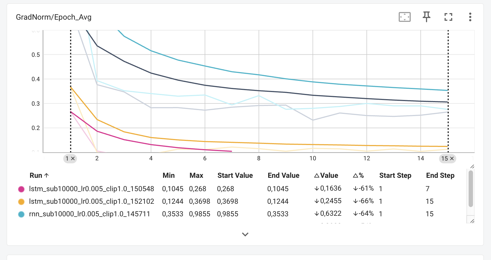
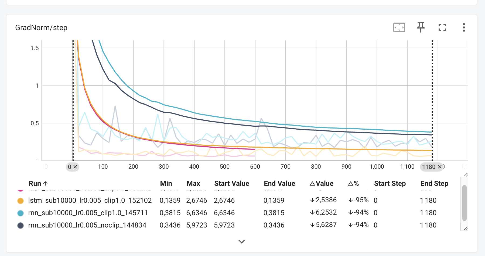
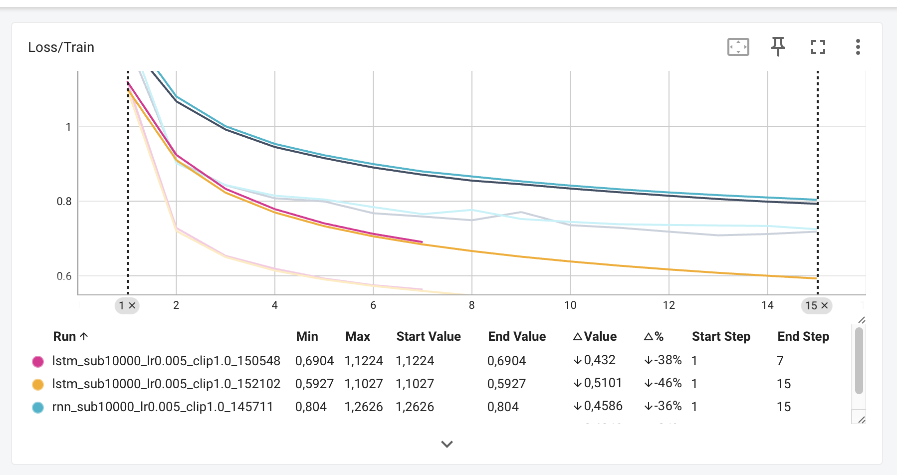
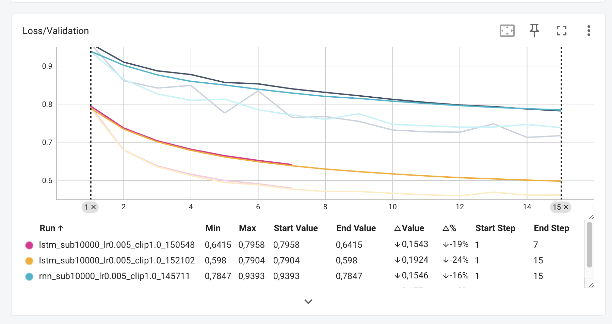

## Exo 1

### Etape 1
#### q1a
1) 
- nb exact de partition pour `train.json`: 214122
- nb exact de partition pour `validation.json`: 2162

2) 
```
X:1
L:1/8
M:4/4
K:Emin
|: E2 EF E2 EF | DEFG AFDF | E2 EF E2 B2 |1 efe^d e2 e2 :|2 efe^d e3 B |: e2 ef g2 fe | defg afdf |1 e2 ef g2 fe | efe^d e3 B :|2 g2 bg f2 af | efe^d e2 e2 ||
 ```
 Résultat de la première partition: 
 

N’ayant pas de connaissances en théorie musicale, j’ai utilisé l'IA pour identifier et expliquer le rôle de ces métadonnées.

```
Les 4 premières lignes sont les métadonnées de la partition, elles décrivent le contexte de la pièce avant même la première note :
X:1 → numéro de la pièce (son identifiant dans un fichier qui peut en contenir plusieurs)
L:1/8 → la durée de note par défaut, ici une croche (1/8). Toutes les notes sans indication de durée durent 1/8.
M:4/4 → la mesure, ici 4 temps par mesure (temps fort classique)
K:Emin → la tonalité, ici Mi mineur. Ça définit les altérations (dièses/bémols) appliquées automatiquement à toutes les notes.
```

### Etape 2
#### q1b

1) Il y a 95 caractères uniques. La longueur moyenne est de 290.1 et la longeur maximum de 2968.

2) Il est indispensable d'appliquer sorted(...) sur le set des caractères uniques avant de créer char_to_index car on doit trier les données et faire en sorte que les mapping (clé, valeur) ne changent pas à chaque exécution. 

Sans sorted(), le mapping char_to_index change à chaque exécution. En rechargeant les poids le lendemain, le modèle lirait les mauvais caractères et génèrerait de la musique incohérente.

3) On a choisi SEQ_LENGTH= 500 plutôt que max_len= 2968 car padder jusqu’à 2968 rendrait chaque séquence environ 6x plus longue: plus lent, plus de mémoire GPU et le modèle passerait son temps à apprendre sur du padding inutile. 500  2x la longueur moyenne, c’est suffisant pour capturer assez de contexte musical.


## Exo 2

### Etape 1

Résultat après exécution du script en ajoutant la class: 
 

- Les tenseurs x et y ont tous les deux la forme (128, 499), avec 128 séquences par batch (BATCH_SIZE) et 499 pas de temps. On a 499 et non 500 car dans le code on a mis x= seq[:-1] et y= seq[1:]. Ils perdent chacun un caractère à cause du décalage.

On utilise torch.long car x et y contiennent des numéros de caractères (des indices), pas des mesures; l’embedding et la loss s’en servent pour retrouver une ligne ou une classe, et un numéro de ligne ne peut pas avoir de virgule.

### Etape 2

1)
calcul :  

résultat avec le scirpt : 

2) Passer l’indice dans une couche linéaire 1 -> embedding_dim donnerait au réseau un ordre qui n’existe pas (le caractère 33 serait « proche » du 34 et « loin » du 94) et tous les caractères seraient sur une même droite, alors que nn.Embedding donne à chaque caractère son propre vecteur appris, sans ordre imposé.

3) Quand on utilise nn.RNN, self.rnn renvoie un seul tenseur h_n, alors qu'avec nn.LSTM il en renvoie deux (h_n, c_n) : h_n est l'état caché, c'est la sortie de la cellule qui est transmise au pas de temps suivant, et c_n est l'état de la cellule, la mémoire à long terme. Elle se met à jour avec la formule c_t = f_t * c_{t-1} + i_t * g_t : on garde une partie de l'ancienne mémoire (porte d'oubli) et on y ajoute de la nouvelle information (porte d'entrée), ce qui fait que l'information n'est pas écrasée à chaque pas de temps.


## Exo 3
1) On doit écrire logits.reshape(-1, vocab_size) et y.reshape(-1) car CrossEntropyLoss attend des logits de forme (N, vocab_size) et des cibles de forme (N), alors que le modèle renvoie des tenseurs 3D (batch_size, seq_len, vocab_size) et 2D (batch_size, seq_len). On aplatit donc le batch et la séquence ensemble pour que chaque caractère soit une prédiction à part. Le -1 vaut batch_size * seq_len, soit 128 * 499 = 63 872 prédictions (pour un batch complet).


2) La focntion clip_grad_norm_ doit être appelée après loss.backward() car c'est backward() qui calcule les gradients; avant, ils n'existent pas encore (ou ils sont vides), donc il n'y aurait rien à limiter. Elle doit être appelée avant optimizer.step() car c'est step() qui utilise les gradients pour modifier les poids; si on clippe après, la mise à jour a déjà été faite avec les gradients non limités et le clipping ne sert à rien.

3) Analyse avec TensorBoard: 

Les deux runs sont très proches: à l'époque 15, le Run 1 finit avec une Val Loss de 0.7173 et une Val Acc de 0.7757, et le Run 2 avec 0.7386 et 0.7699. Sur GradNorm/step, la norme des gradients vaut environ 6 au début puis passe sous 1.0 après 100 à 150 pas, donc le clipping à 1.0 ne limite les gradients que pendant ces premiers pas. Le clipping corrige le problème de l'exploding gradient (des gradients trop gros qui font diverger l'entraînement), mais ici il n'y en a pas vraiment: le Run 1 sans clipping ne diverge pas, donc le clipping sert seulement de sécurité.











4) L'Accuracy/Validation est artificiellement optimiste car une partition de 250 caractères paddée jusqu'à 500 contient 250 espaces à la fin, que le modèle prédit presque toujours correctement (après un espace de padding, le caractère suivant est toujours un espace). Ces prédictions faciles comptent comme les autres et font monter l'accuracy sans que le modèle ait appris à prédire de la musique. On peut éviter de compter le padding dans la perte avec `nn.CrossEntropyLoss(ignore_index=char_to_index[' '])`, ce qui ignore les positions dont la cible est un espace.

---
Ouptut code: 
```cmd
X:1
L:1/8
M:4/4
K:Emin
|: E2 EF E2 EF | DEFG AFDF | E2 EF E2 B2 |1 efe^d e2 e2 :|2 efe^d e3 B |: e2 ef g2 fe | 
 defg afdf |1 e2 ef g2 fe | efe^d e3 B :|2 g2 bg f2 af | efe^d e2 e2 ||
Taille du vocabulaire : 95 caractères uniques
Longueur moyenne : 290.1 | Longueur max : 2968
[rnn_sub10000_lr0.005_noclip_144834] Epoch 1/15:   0%|                                                     | 0/79 [00:00<?, ?it/s]/mnt/hdd/homes/daberkane/miniforge3/envs/deeplearning/lib/python3.10/site-packages/torch/utils/data/dataloader.py:1102: UserWarning: 'pin_memory' argument is set as true but no accelerator is found, then device pinned memory won't be used.
  super().__init__(loader)
Epoch 01 | Train Loss: 1.2300 | Val Loss: 0.9594 | Val Acc: 0.7161 | Avg GradNorm: 0.696                                          
Epoch 02 | Train Loss: 0.9079 | Val Loss: 0.8616 | Val Acc: 0.7358 | Avg GradNorm: 0.377                                          
Epoch 03 | Train Loss: 0.8430 | Val Loss: 0.8422 | Val Acc: 0.7395 | Avg GradNorm: 0.347                                          
Epoch 04 | Train Loss: 0.8079 | Val Loss: 0.8491 | Val Acc: 0.7416 | Avg GradNorm: 0.283                                          
Epoch 05 | Train Loss: 0.7995 | Val Loss: 0.7765 | Val Acc: 0.7571 | Avg GradNorm: 0.283                                          
Epoch 06 | Train Loss: 0.7678 | Val Loss: 0.8349 | Val Acc: 0.7495 | Avg GradNorm: 0.272                                          
Epoch 07 | Train Loss: 0.7589 | Val Loss: 0.7648 | Val Acc: 0.7599 | Avg GradNorm: 0.285                                          
Epoch 08 | Train Loss: 0.7490 | Val Loss: 0.7674 | Val Acc: 0.7601 | Avg GradNorm: 0.291                                          
Epoch 09 | Train Loss: 0.7709 | Val Loss: 0.7547 | Val Acc: 0.7649 | Avg GradNorm: 0.293                                          
Epoch 10 | Train Loss: 0.7357 | Val Loss: 0.7321 | Val Acc: 0.7716 | Avg GradNorm: 0.232                                          
Epoch 11 | Train Loss: 0.7287 | Val Loss: 0.7275 | Val Acc: 0.7721 | Avg GradNorm: 0.261                                          
Epoch 12 | Train Loss: 0.7183 | Val Loss: 0.7265 | Val Acc: 0.7736 | Avg GradNorm: 0.251                                          
Epoch 13 | Train Loss: 0.7085 | Val Loss: 0.7483 | Val Acc: 0.7635 | Avg GradNorm: 0.247                                          
Epoch 14 | Train Loss: 0.7120 | Val Loss: 0.7128 | Val Acc: 0.7767 | Avg GradNorm: 0.252                                          
Epoch 15 | Train Loss: 0.7184 | Val Loss: 0.7173 | Val Acc: 0.7757 | Avg GradNorm: 0.265                                          
Epoch 01 | Train Loss: 1.2626 | Val Loss: 0.9393 | Val Acc: 0.7181 | Avg GradNorm: 0.985                                          
Epoch 02 | Train Loss: 0.9016 | Val Loss: 0.8651 | Val Acc: 0.7331 | Avg GradNorm: 0.393                                          
Epoch 03 | Train Loss: 0.8434 | Val Loss: 0.8269 | Val Acc: 0.7447 | Avg GradNorm: 0.352                                          
Epoch 04 | Train Loss: 0.8149 | Val Loss: 0.8099 | Val Acc: 0.7466 | Avg GradNorm: 0.340                                          
Epoch 05 | Train Loss: 0.8047 | Val Loss: 0.8131 | Val Acc: 0.7471 | Avg GradNorm: 0.330                                          
Epoch 06 | Train Loss: 0.7842 | Val Loss: 0.7852 | Val Acc: 0.7566 | Avg GradNorm: 0.335                                          
Epoch 07 | Train Loss: 0.7653 | Val Loss: 0.7715 | Val Acc: 0.7612 | Avg GradNorm: 0.294                                          
Epoch 08 | Train Loss: 0.7768 | Val Loss: 0.7601 | Val Acc: 0.7640 | Avg GradNorm: 0.332                                          
Epoch 09 | Train Loss: 0.7523 | Val Loss: 0.7747 | Val Acc: 0.7607 | Avg GradNorm: 0.276                                          
Epoch 10 | Train Loss: 0.7446 | Val Loss: 0.7469 | Val Acc: 0.7680 | Avg GradNorm: 0.280                                          
Epoch 11 | Train Loss: 0.7382 | Val Loss: 0.7434 | Val Acc: 0.7687 | Avg GradNorm: 0.288                                          
Epoch 12 | Train Loss: 0.7364 | Val Loss: 0.7397 | Val Acc: 0.7704 | Avg GradNorm: 0.300                                          
Epoch 13 | Train Loss: 0.7350 | Val Loss: 0.7400 | Val Acc: 0.7686 | Avg GradNorm: 0.290                                          
Epoch 14 | Train Loss: 0.7338 | Val Loss: 0.7465 | Val Acc: 0.7676 | Avg GradNorm: 0.290                                          
Epoch 15 | Train Loss: 0.7248 | Val Loss: 0.7386 | Val Acc: 0.7699 | Avg GradNorm: 0.276                                          
Epoch 01 | Train Loss: 1.1224 | Val Loss: 0.7958 | Val Acc: 0.7555 | Avg GradNorm: 0.268                                          
Epoch 02 | Train Loss: 0.7282 | Val Loss: 0.6794 | Val Acc: 0.7841 | Avg GradNorm: 0.106                                          
Epoch 03 | Train Loss: 0.6534 | Val Loss: 0.6379 | Val Acc: 0.7957 | Avg GradNorm: 0.084                                          
Epoch 04 | Train Loss: 0.6189 | Val Loss: 0.6161 | Val Acc: 0.8016 | Avg GradNorm: 0.072                                          
Epoch 05 | Train Loss: 0.5925 | Val Loss: 0.5997 | Val Acc: 0.8066 | Avg GradNorm: 0.070                                          
Epoch 06 | Train Loss: 0.5745 | Val Loss: 0.5910 | Val Acc: 0.8094 | Avg GradNorm: 0.070                                          
Epoch 07 | Train Loss: 0.5631 | Val Loss: 0.5793 | Val Acc: 0.8122 | Avg GradNorm: 0.068                                          
[lstm_sub10000_lr0.005_clip1.0_150548] Epoch 8/15:  37%|███████████████▍                          | 29/79 [00:25<00:43,  1.15it/s]srun: Job step aborted: Waiting up to 32 seconds for job step to finish.
[2026-11-05T15:14:47.010] error: *** STEP 54428.0 ON starfighter-slurm-node-01-1 CANCELLED AT 2026-11-05T15:14:47 DUE TO TIME LIMIT ***
[lstm_sub10000_lr0.005_clip1.0_150548] Epoch 8/15:  78%|████████████████████████████████▉         | 62/79 [00:55<00:15,  1.08it/s]srun: error: Timed out waiting for job step to complete
Nombre de chansons (Train) : 214122
Nombre de chansons (Val)   : 2162

--- Exemple de partition (Train[0]) ---
X:1
L:1/8
M:4/4
K:Emin
|: E2 EF E2 EF | DEFG AFDF | E2 EF E2 B2 |1 efe^d e2 e2 :|2 efe^d e3 B |: e2 ef g2 fe | 
 defg afdf |1 e2 ef g2 fe | efe^d e3 B :|2 g2 bg f2 af | efe^d e2 e2 ||
Taille du vocabulaire : 95 caractères uniques
Longueur moyenne : 290.1 | Longueur max : 2968
[lstm_sub10000_lr0.005_clip1.0_152102] Epoch 1/15:   0%|                                                   | 0/79 [00:00<?, ?it/s]Nombre de chansons (Train) : 214122
Nombre de chansons (Val)   : 2162

--- Exemple de partition (Train[0]) ---
X:1
L:1/8
M:4/4
K:Emin
|: E2 EF E2 EF | DEFG AFDF | E2 EF E2 B2 |1 efe^d e2 e2 :|2 efe^d e3 B |: e2 ef g2 fe | 
 defg afdf |1 e2 ef g2 fe | efe^d e3 B :|2 g2 bg f2 af | efe^d e2 e2 ||
Taille du vocabulaire : 95 caractères uniques
Longueur moyenne : 290.1 | Longueur max : 2968
Epoch 01 | Train Loss: 1.1027 | Val Loss: 0.7904 | Val Acc: 0.7556 | Avg GradNorm: 0.370                                          
Epoch 02 | Train Loss: 0.7201 | Val Loss: 0.6791 | Val Acc: 0.7846 | Avg GradNorm: 0.100                                          
Epoch 03 | Train Loss: 0.6501 | Val Loss: 0.6357 | Val Acc: 0.7964 | Avg GradNorm: 0.085                                          
Epoch 04 | Train Loss: 0.6138 | Val Loss: 0.6128 | Val Acc: 0.8029 | Avg GradNorm: 0.092                                          
Epoch 05 | Train Loss: 0.5901 | Val Loss: 0.5943 | Val Acc: 0.8082 | Avg GradNorm: 0.113                                          
Epoch 06 | Train Loss: 0.5726 | Val Loss: 0.5885 | Val Acc: 0.8098 | Avg GradNorm: 0.112                                          
Epoch 07 | Train Loss: 0.5591 | Val Loss: 0.5772 | Val Acc: 0.8144 | Avg GradNorm: 0.122                                          
Epoch 08 | Train Loss: 0.5470 | Val Loss: 0.5707 | Val Acc: 0.8161 | Avg GradNorm: 0.115                                          
Epoch 09 | Train Loss: 0.5353 | Val Loss: 0.5709 | Val Acc: 0.8156 | Avg GradNorm: 0.105                                          
Epoch 10 | Train Loss: 0.5279 | Val Loss: 0.5662 | Val Acc: 0.8164 | Avg GradNorm: 0.117                                          
Epoch 11 | Train Loss: 0.5196 | Val Loss: 0.5623 | Val Acc: 0.8179 | Avg GradNorm: 0.114                                          
Epoch 12 | Train Loss: 0.5127 | Val Loss: 0.5595 | Val Acc: 0.8197 | Avg GradNorm: 0.105                                          
Epoch 13 | Train Loss: 0.5063 | Val Loss: 0.5692 | Val Acc: 0.8168 | Avg GradNorm: 0.114                                          
Epoch 14 | Train Loss: 0.5057 | Val Loss: 0.5612 | Val Acc: 0.8189 | Avg GradNorm: 0.104                                          
Epoch 15 | Train Loss: 0.4964 | Val Loss: 0.5616 | Val Acc: 0.8200 | Avg GradNorm: 0.113     
````