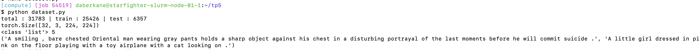
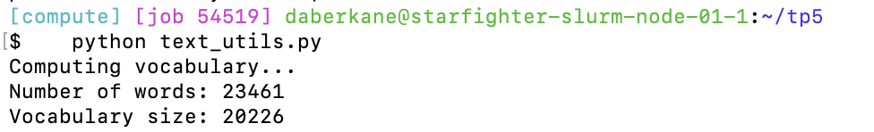
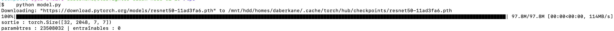
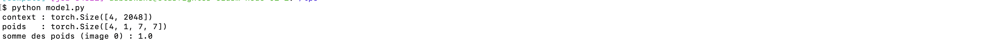
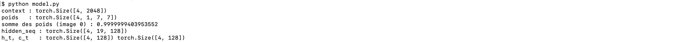
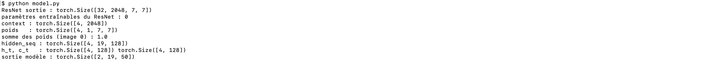
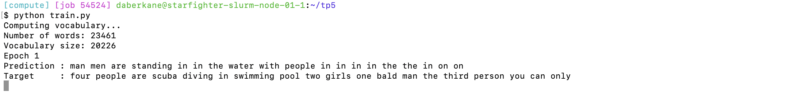
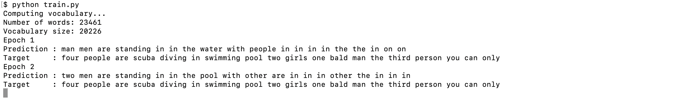

## Exo 1

1) On fait un resize en 224×224 parce que sinon on ne peut pas regrouper les images en batch si elles n’ont pas toutes la même taille. Le DataLoader regroupe 32 images en un seul tenseur(32, 3, H, W). Du coup ça exige que toutes aient la même taille. En plus de ça, ResNet50 a été pré-entraîné sur des images de cette taille donc l’échelle des objets reste proche de ce qu’il connaît.

Résultat `dataset.py`:

Résultat `text_utils.py`:

## Exo 2

Résultat `model.py`:

1) Si on ne gelait pas ResNet, ses poids seraient modifiés par les erreurs du LSTM (encore aléatoire au début), et il perdrait une partie de ce qu’il avait déjà appris.
L'ordinateur devrait calculer et stocker les millions de gradients et ceci demanderait plus de mémoire et rendrait chaque pas d'entraînement plus lent.

2) La sortie a la forme (32, 2048, 7, 7) qui correspond à 32 images, 2048 canaux, et une grille spatiale de 7×7(la résolution est divisée par 32: 224/32 = 7).

## Exo 3

Résultat `model.py`:

1) Le context_vector est un résumé de l’image calculé à chaque mot. C’est une moyenne des 49 zones de la grille, pondérée par les poids d’attention, qui donnent plus d’importance aux zones utiles pour le mot en cours. 
Dans un Seq2Seq de base, toute l’image est résumée en un seul vecteur fixe. Ceci créé un goulot d’étranglement et du coup beaucoup de détails sont perdus. L’attention le résout en recalculant un contexte différent à chaque mot tout ça adapté à ce que le décodeur écrit.

----  
partie 3b) - Résultat `model.py`:

## Exo 4 

Résultat `model.py`:

--- 

FYI : l’entraînement a été réalisé sur un sous-ensemble (960 images, 6 époques) à cause de la limite de temps de l’allocation Slurm